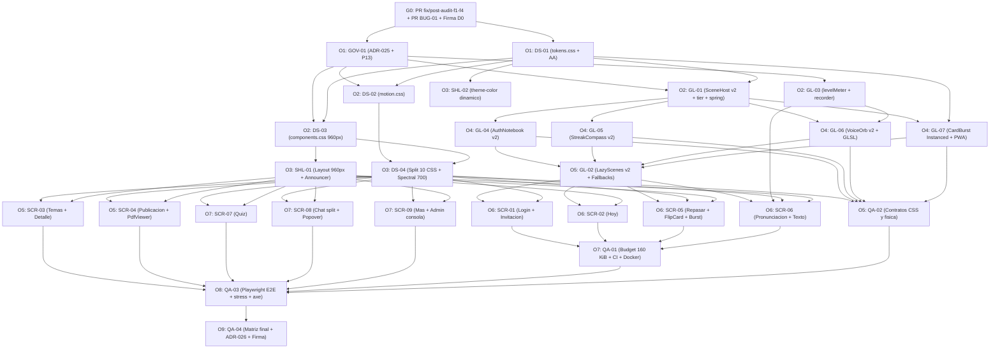

# P13 — Cahier Atelier 3D, Edición Definitiva

> **For agentic workers:** Lee `AGENTS.md`, ADR-025 y este plan antes de tomar una tarea. En `tasks.yaml` no se mutan tareas ni `owns` de P01–P12 (R-31). La lista real de archivos de cada tarea es **Touches**; `owns` solo registra rutas que nadie poseía.

**Goal:** Cerrar los bugs que quedan después de F1–F4 (fugas de SQLite, contraste del botón de grabar, identidad visual partida, reloj de movimiento duplicado, riel y quiebres en conflicto) e implementar «Cahier Atelier 3D — Edición Definitiva»: una paleta, tres voces, un quiebre a 960 px, un reloj y cuatro escenas WebGL con un solo renderer.

**Architecture:** Tres trenes desacoplados, para que un rollback de diseño no revierta backend ni la auditoría. `fix/post-audit-f1-f4` entra primero; `fix/bug-01-resource-warnings` cierra `BUG-01`; `feat/cahier-atelier-3d-definitiva` integra las ondas 1–9 con merges `--no-ff` y solo abre el PR a `main` tras G8, el job `Smoke arm64` y la firma de `ADR-026` (`QA-04`).

**Tech Stack:** el del repo. `three@0.187.0` ya está fijado. Cero paquetes nuevos, cero `react-three-fiber` / `drei` / `three/addons` / `.glb`. `@fontsource/spectral@5.3.0` ya incluye `latin-700.css`.

**Decisión:** [ADR-025](../../decisions/ADR-025-cahier-atelier-3d-edicion-definitiva.md). ADR-018 y ADR-023 siguen aceptados en lo que 025 no reemplaza (Seyès solo donde hay francés, un oficio por color, texto libre, `three` diferido, `frances.motion3d`).

**Registro:** mapa `P13` en `docs/superpowers/plans/tasks.yaml`. Las 28 tareas, sus `deps`, sus `owns` (R-31) y sus `Touches` están en la sección 4. Las ondas y las compuertas G0–G9 están en la sección 5.

Este documento es la fuente de implementación. Las cuatro secciones de auditoría (bugs y shell, pantallas, WebGL, QA) quedaron armonizadas aquí; no hay fuentes fuera del repo.

---

## 1. Resumen Ejecutivo, Invariantes y Compuerta de Decisión D0

### 1.1 Alcance e invariantes innegociables

1. **Exclusión explícita del dueño:** `POST /api/speech/usage` (`src/frances/api/routes/speech.py:221-231`) **NO se modifica** (sin rate-limit de abuso de cuota ni cambios de contrato).
2. **Contratos congelados:** Ninguna tarea toca `src/frances/models/`, `src/frances/db/migrations/`, `contracts/` ni `web/src/contracts/`. Cero migraciones SQL nuevas, cero `frances schema export` con diff, cero `gen:types` con diff.
3. **Cero dependencias nuevas:** No se añaden paquetes a `pyproject.toml` ni a `web/package.json`. `@fontsource/spectral@5.3.0` ya incluye `latin-700.css`, `three@0.187.0` ya está fijado exacto, y cero `react-three-fiber` / `drei` / `three/addons` / `.glb`.
4. **Cero datos reales:** Todo fixture sale de `tests/fixtures/make_fixtures.py` o del modo demo sintético (`VITE_E2E=1`); `web/scripts/check-no-demo.mjs` permanece activo en CI y Dockerfile.
5. **TDD estricto y cero waivers:** Cada una de las **28 tareas** escribe el test rojo primero, implementa, pasa a verde y deja **100 % verde la compuerta de su onda** sin desactivar lint, tipos, axe ni `--disable-socket`.
6. **No reabrir F1–F4:** Esos arreglos ya están en la historia de la rama (clase `motion-off` en `<html>`, `--c-success` en el anillo, `matchMedia` oscuro en `createSceneHost`, cierre de `Store` en los 10 CLI ya parcheados, `libgomp1`, `cap_drop`, `?error=max_users`). La auditoría que fijó este plan los midió en verde (`1,448` tests Python, `538` tests Vitest, `62/62` Playwright E2E v2). No se revierten.

### 1.2 Compuerta D0 — Las 5 decisiones del dueño (obligatoria antes de Onda 1)

Antes de ejecutar la primera tarea de diseño (`GOV-01` / `DS-01`), el dueño debe marcar **Aprobar** en las 5 decisiones congeladas de la propuesta. Cualquier «Pedir cambio» detiene la ejecución hasta ajustar el plan.

| # | Decisión | Efecto congelado en este Plan Maestro |
|---|---|---|
| **1** | **Paleta única y `--c-gold-3d`** | Papel Seyès `#f8f6ed`, pizarra nocturna `#10131a`, tinta `#2147a3` / `#98b9fa`, botón grabar AA `#a02a26` / `#a63933`. El metal WebGL se llama **`--c-gold-3d`** (`#d3ac41` / `#d9b65e`, campo `gold3d`), nunca `--c-brass`, y queda prohibido en `color:`. |
| **2** | **Anillo de puntaje (`ScoreRing`)** | Arco proporcional continuo coloreado con `var(--c-score-${band})`, cifra central en `--c-text` tabular, icono SVG distintivo y palabra de banda. Nunca un `strokeDasharray` discontinuo sobre el mismo círculo animado. |
| **3** | **Refinamientos de `SceneHost v2`** | `unmasked(gl)` acepta `WebGL2RenderingContext \| WebGLRenderingContext \| null`; puntero en `window` ignora todo `pointerType !== 'mouse'`; watchdog llama `resize()` solo cuando `dprCap` cambia; snap exacto `palette[k].copy(to[k])` cuando `mix > 0.999`. |
| **4** | **Frontera estricta del 3D** | Solo **4 escenas**: Cuaderno (`/entrar`), Brújula (`/`), Orbe (`/repasar/pronunciacion`, `/repasar/texto`) y Ráfaga (`/repasar`). Publicación, Chat, Admin, Quiz, Temas, Ajustes y el volteo de `FlipCard` permanecen 100 % DOM/CSS. |
| **5** | **Secuencia por ondas** | Tokens y movimiento antes que escenas y pantallas; cada onda cierra en verde en la rama de integración antes de abrir la siguiente. |

### 1.3 Estrategia de ramas y PRs (aislamiento de rollback)

Tres trenes de integración completamente desacoplados para que un rollback de diseño nunca revierta arreglos de seguridad/backend:

1. **`fix/post-audit-f1-f4` → PR a `main`** (4 commits atómicos desde el working tree actual: **F1** auth/plan, **F2** web fixes, **F3** backend core, **F4** infra/docs).
2. **`fix/bug-01-resource-warnings` → PR a `main`** (cortada desde `main` ya con F1–F4; 1 commit con `BUG-01`).
3. **`feat/cahier-atelier-3d-definitiva` → PR único a `main`** (cortada desde `main` tras fusionar 1 y 2 y firmar D0). Las ondas 1–9 se integran aquí mediante merges `--no-ff` desde worktrees `--worktree new-child`; el PR a `main` se abre solo tras pasar G8, `Smoke arm64` y la firma del dueño en `ADR-026` (`QA-04`).

---

## 2. Inventario Verificado de Bugs Remanentes (Post-F1/F2/F3/F4)

### 2.1 Backend Python — 3 `ResourceWarning` activos + 4 rutas CLI latentes (`BUG-01`)

Evidencia medida en el árbol actual con `uv run pytest --no-cov -W always -q` (`1448 passed`, `3 ResourceWarning`):

| # | Archivo y línea real | Causa raíz | Tarea |
|---|---|---|---|
| **B1** | `src/frances/db/store.py:85-133` | `_configured_connection` abre `sqlite3.connect` (`:89`) y si falla el bucle de PRAGMA (`DatabaseError` en DB corrupta, p. ej. `health.py:67`) o `_schema_version` (`:97-100`), abandona la conexión sin `conn.close()`. Genera 2 de los 3 avisos de la suite. | `BUG-01` |
| **B2** | `src/frances/sync/run.py:107-111` | `sync` y `reconcile` abren `Store` vía `make_context(data)` sin `try ... finally: ctx.store.close()`. Genera el 3.er aviso de la suite (visible en `test_sync_cli_auth_failure_exits_3`). | `BUG-01` |
| **B3** | `src/frances/fetch/run.py:350`, `src/frances/extract/run.py:224`, `src/frances/cards/phonemes.py:199` | Mismo patrón sin `finally: ctx.store.close()` (`test_fetch_cli_reports_partial` ya emite `ResourceWarning` aislado). | `BUG-01` |

### 2.2 Frontend CSS, Layout, A11y y Pantallas (19 bugs verificados)

| # | Bug verificado en el árbol vivo | Ubicación exacta | Tarea |
|---|---|---|---|
| **F1** | Botón de grabar oscuro fuera de WCAG AA (`#ffffff` sobre `#dc3b49` = **4.41:1 < 4.5**) | `web/src/design/tokens.css:189` | `DS-01` |
| **F2** | Identidad partida (papel frío `#f7f7fb`, verde-pizarra `#121917`, `--c-gold` mezclado texto/metal, falta `--c-gold-3d`) | `web/src/design/tokens.css:29-50` | `DS-01` |
| **F3** | Doble reloj de movimiento (`motion.css:7-11` redeclara `--dur-med`/`--dur-slow`; `motion-off` y `reduced-motion` no apagan las 5 duraciones) | `web/src/design/tokens.css:153-156`, `web/src/design/motion.css:7-11` | `DS-01` + `DS-02` |
| **F4** | Medidor de aviso de cuota Azure pintado en `--c-danger` en vez de `--c-warning` | `web/src/design/motion.css:385-387` | `DS-02` |
| **F5** | Hover asigna `box-shadow` sin `@media (hover: hover)`; `.flip-tilt` mantiene `will-change: transform` en reposo y `200ms` literal; huecos de `6px` fuera de rejilla de 8 | `web/src/design/motion.css:37-43`, `web/src/design/components.css:1453` | `DS-02` + `DS-03` |
| **F6** | Transiciones fuera de GPU (`.btn` anima `background`/`border-color`, `.tabbar a .pill` anima `background`, `.progress > span` anima `width`) | `web/src/design/components.css:249-252` | `DS-03` |
| **F7** | Columna capada a `760px` en escritorio, riel mudo de `88px` (900–1199px), quiebres en conflicto (`900`/`960`/`1100`/`1200`), `content-wide` pisado (`1080` vs `1020`), `<main>` no reserva altura de barra fija móvil | `web/src/design/components.css:152-230`, `web/src/design/motion.css:53-59`, `web/src/shell/Layout.tsx:37-40` | `DS-02` + `DS-03` + `SHL-01` |
| **F8** | `<meta name="theme-color">` estático `#2b37b8` (no sigue tema claro/oscuro) | `web/index.html:9`, `web/src/design/theme.ts:9-21` | `SHL-02` |
| **F9** | IPA en Spectral *italic* en lugar de `var(--font-mono)` recto | `web/src/design/components.css:658-663` | `DS-03` |
| **F10** | Botonera FSRS sin rejilla `2×2` bajo `380px` (rótulos cortados a `320px`) | `web/src/design/components.css:737-741` | `DS-03` + `SCR-05` |
| **F11** | Sin `RouteAnnouncer` (`aria-live="polite"`) al cambiar de ruta | `web/src/shell/Layout.tsx:95` | `SHL-01` |
| **F12** | `FlipCard` inclina con dedo (`handleTiltMove` no filtra `pointerType !== 'mouse'`) | `web/src/screens/repasar/FlipCard.tsx:57-71` | `SCR-05` |
| **F13** | Doble disparo de `CardBurst` al cerrar sesión con Bien/Fácil en la última tarjeta | `web/src/screens/repasar/Repasar.tsx:230-245` | `GL-07` + `SCR-05` |
| **F14** | `ScoreSummary` agrupa `excelente`+`bien` en `.good`, deja `mejorable` en acento, y hereda color de banda en la cifra central | `web/src/ui/pron/ScoreSummary.tsx:26-53` | `SCR-06` |
| **F15** | `PracticeSession` envuelve toda la pantalla (incl. puntaje/botones) en `.paper`; botón grabar distinto al círculo 72px de `SpeakPanel`; falta `aria-pressed` y háptica | `web/src/ui/pron/PracticeSession.tsx:231-250` | `SCR-06` |
| **F16** | `PdfViewer` traga fallos de `page.render` en silencio (`.catch(() => undefined)`); `.pub-split` tiene DOM invertido (ficha antes de material) | `web/src/ui/viewers/PdfViewer.tsx:68`, `web/src/screens/publicacion/Publicacion.tsx:225-347` | `SCR-04` |
| **F17** | `Login` muestra portada 2 cols en `320px` (solape), `?status=pending` con piel `callout info`, `.btn-google` a 44px; `Invitacion` sin portada/esqueleto ni enlace a `/entrar` en token inválido | `web/src/auth/Login.tsx:149-157`, `web/src/auth/Invitacion.tsx:128-140` | `SCR-01` |
| **F18** | `Chat` renderiza lista+cuerpo en móvil sin split `≥960px`, chips disparan `POST` inmediato en vez de rellenar el compositor, citas `[n]` sin vista previa | `web/src/screens/chat/Chat.tsx:272-328`, `web/src/screens/chat/MessageList.tsx:78-87` | `SCR-08` |
| **F19** | `Hoy` y `PracticeSession` dejan huecos vacíos (`.hoy-compass-slot`, `.orb-wrap`) cuando el 3D está apagado (`fallback` omitido → `null`) | `web/src/screens/hoy/Hoy.tsx:169-172`, `web/src/ui/pron/PracticeSession.tsx:231-237` | `GL-02` + `SCR-02` + `SCR-06` |

### 2.3 Capa Three.js / WebGL, Audio y PWA (10 bugs verificados)

| # | Bug verificado | Ubicación exacta | Tarea |
|---|---|---|---|
| **G1** | Nuevo `WebGLRenderer` por cada ruta → agota tope de contextos en iOS Safari / WebKit y deja lienzo negro | `web/src/three/createSceneHost.ts:127-131` | `GL-01` |
| **G2** | `NoToneMapping` + suma de luces clipea papel a blanco; `antialias: true` + DPR 2 caro en móvil; `onPointerMove` despierta `rAF` con dedo; `dispose` sin `Set` ni texturas ni `webglcontextlost` | `web/src/three/createSceneHost.ts:127-272` | `GL-01` |
| **G3** | `MeshPhysicalMaterial` + `transparent: true` superfluos en las 4 escenas; `import * as THREE` impide tree-shaking | `web/src/three/*.tsx` | `GL-04`..`GL-07` |
| **G4** | `AuthNotebookScene` son 3 cajas + 2 toros en seno perpetuo (imposible 0 `rAF` en reposo) | `web/src/three/AuthNotebookScene.tsx:40-121` | `GL-04` |
| **G5** | `StreakCompassScene` aumenta nerviosismo con la racha (`min(streak, 21)/21`) y pinta el sur con `palette.danger` | `web/src/three/StreakCompassScene.tsx:47-56` | `GL-05` |
| **G6** | `VoiceOrbScene` ignora audio real (pulso falso `sin(elapsed*8)`), pinta grabando en `danger`, y usa umbrales 80/60 incoherentes con `scoreBand` (90/75/60); `SpeakPanel` no monta orbe | `web/src/three/VoiceOrbScene.tsx:97-110` | `GL-03` + `GL-06` + `SCR-06` |
| **G7** | `CardBurstScene` mantiene un canvas `position: fixed; inset: 0` pintando 60 fps toda la sesión con 20 `Mesh`/materiales tras el primer «Bien» | `web/src/three/CardBurstScene.tsx:36-90`, `web/src/design/motion.css:230-235` | `DS-02` + `GL-07` |
| **G8** | PWA precachea `three` para usuarios con `reduced-motion` / `motion-off`; sin `manualChunks`, Workbox no puede excluirlo | `web/src/sw/pwaConfig.ts:68-69`, `web/vite.config.ts:8-11` | `GL-07` + `QA-01` |
| **G9** | Fallo dentro de `useEffect` de WebGL deja un `
` vacío (fuera de `SceneBoundary`) | `web/src/three/LazyScenes.tsx:15-23` | `GL-01` + `GL-02` |
| **G10** | Sin `AnalyserNode` reutilizando el `MediaStream` de `recorder.ts` (abrir 3.ª captura rompería iOS Safari) | `web/src/pron/recorder.ts:156`, `web/src/screens/texto/SpeakPanel.tsx:137-159` | `GL-03` + `SCR-06` |

---

## 3. Decisiones de Armonización del Orquestador (12 conflictos resueltos)

Al cruzar las cuatro secciones de este plan se detectaron y resolvieron **12 discrepancias críticas** antes de escribir este plan unificado:

1. **Trampa de `tokens.test.ts` (`PAIRS_TEXT` + selector `:root`):** Verificado en `web/src/design/tokens.test.ts:16-58`: `palette()` busca el selector exacto `:root` (no `:root, :root.theme-light`) y parsea solo hex literales `/#[\da-fA-F]{6}/` (no resuelve `var()`), exigiendo `--c-streak`, `--c-streak-soft` y `--c-rate-*`. **Resolución:** Mantener `:root` / `:root:not(.theme-light)` / `:root.theme-dark` y publicar **hex literal** en todos los tokens de `PAIRS_TEXT` (incluido `--c-streak` = `#714d00`/`#d7d688` y `--c-rate-*`); solo `--c-info`, `--c-info-soft`, `--c-ok` y `--c-score-*` usan `var(...)`.
2. **Propiedad `owns` en `tasks.yaml` (regla R-31):** Verificado en `tests/agents/test_tasks_check.py:135-145`: las tareas P01–P07 tienen olas fijas `[6,7,16,14,12,7,4,2,2,2,1]` y `owns` históricos con `/` final (`web/src/design/`, `web/src/shell/`, etc.). **Resolución:** No mutar los `owns` históricos; toda tarea P13 que edita rutas ya poseídas se registra con `owns: []` en `tasks.yaml` y una lista **`Touches:`** estrictamente disjunta en P13. Solo rutas sin dueño previo (`ADR-025`, `ADR-026`, P13, `web/src/three/*`, `web/src/screens/texto/*`, `web/src/pron/levelMeter.ts`, `web/scripts/check-three-budget.mjs`) van en `owns:`.
3. **Extracción CSS de pantallas (`DS-04`):** Se unifica en **CSS co-ubicado por pantalla** (`auth.css`, `hoy.css`, `temas.css`, `publicacion.css`, `repasar.css`, `pron.css`, `texto.css`, `quiz.css`, `chat.css`, `admin.css`), ejecutado como extracción mecánica pura en `DS-04` (Onda 3, después de limpiar `motion.css` en `DS-02` y `components.css`/`legacy.css` en `DS-03`), desbloqueando el paralelismo total de `SCR-01..09`.
4. **Nombres de clase de ancho en `<main>`:** Se congelan los nombres canónicos `.content` (`720px`), `.content.content-repasar` (`840px`) y `.content.content-split` (`1120px`), eliminando `.content-wide` (se descartan los alias alternativos `content-narrow`/`content-stage`).
5. **Campo metálico de `Palette`:** `SceneHost v2` expone `gold3d: Color` desde `--c-gold-3d` (`#d3ac41` / `#d9b65e`). El adaptador temporal `mountThreeScene` mapea `gold3d.getHex()` → `palette.gold` para no romper escenas no migradas hasta Onda 4. `GL-01` es el único escritor de `createSceneHost.ts`.
6. **Cero doble escritor en `PracticeSession.tsx` y `SpeakPanel.tsx`:** `GL-03` solo toca `web/src/pron/{levelMeter,recorder,practiceHooks}.ts`; `GL-06` solo toca `web/src/three/{VoiceOrbScene,orbShader}`; **`SCR-06` es el único escritor** de `PracticeSession.tsx`, `SpeakPanel.tsx`, `AcousticCabin.tsx`, `ScoreSummary.tsx` y `WordList.tsx`.
7. **Cero doble escritor en `Repasar.tsx` y `FlipCard.tsx`:** `GL-07` solo toca `web/src/three/{burstPhysics,CardBurstScene,burstShader}` y `pwaConfig.ts`; **`SCR-05` es el único escritor** de `Repasar.tsx` (migra `burstCount` → `BurstRequest` vía `burstOnRate`/`burstOnFinish`), `FlipCard.tsx` (filtro `pointerType === 'mouse'` + swipe opcional), `RatingBar.tsx`, `AudioPlayer.tsx` y `CardAudio.tsx`.
8. **Orden exacto de `GL-02` (Onda 5) para `tsc --noEmit` verde en cada onda:** Las 4 escenas v2 (`GL-04..07`) entran primero en Onda 4 aceptando props v2 opcionales (`meterRef?`, `request?`) junto a las legadas (`level?`, `trigger?`), de modo que `LazyScenes.tsx` v1 sigue compilando en G4. En Onda 5, **`GL-02`** actualiza `LazyScenes.tsx` una sola vez con los fallbacks editoriales y las firmas finales, justo antes de que las 4 pantallas con 3D (`SCR-01`, `SCR-02`, `SCR-05`, `SCR-06`) corran en paralelo en Onda 6.
9. **Test `namedImports.test.ts` movido de `GL-07` a `QA-02` (Onda 5):** Evita falsos rojos en el worktree paralelo de `GL-07` durante Onda 4; G4 lo verifica con `rg` tras el merge y `QA-02` lo fija de forma permanente.
10. **Script de presupuesto de bundle y `vite.config.ts`:** Nombre canónico **`web/scripts/check-three-budget.mjs`** (con `evaluateDist` exportado + `check-three-budget.test.ts`), `manualChunks`, `ci.yml`, `e2e.yml` (paso guardián) y `Dockerfile` concentrados en **`QA-01`** (Onda 7). `GL-07` solo toca `pwaConfig.ts` + `pwaConfig.test.ts` (Onda 4).
11. **Playwright E2E consolidado en `QA-03` (Onda 8):** Un único escritor sobre `web/e2e-v2/**` y el split `@stress` en `e2e.yml`, integrando todas las aserciones de host/fallback/orb/burst/estrés/axe/LCP sin colisiones ni falsos rojos durante las ondas de pantallas.
12. **Alcance completo de `BUG-01`:** Incluye los 5 módulos Python con fugas reales o latentes (`store.py`, `sync/run.py` ambos comandos, `fetch/run.py`, `extract/run.py`, `cards/phonemes.py`), cerrado con `uv run pytest --no-cov -W error::ResourceWarning -q`.

---

## 4. Catálogo Completo de las 28 Tareas

Complejidad: **S** (≤ ½ día), **M** (1–2 días), **L** (2–4 días). En cada tarea, `owns` indica lo que se registra en `tasks.yaml` (respetando R-31) y `Touches` lista cada archivo real que el subagente tiene permitido modificar.

### 4.0 Pre-Onda — Cierre Backend (`fix/bug-01-resource-warnings`)

#### `BUG-01` — Cerrar fugas de conexión SQLite (`0 ResourceWarning` en toda la suite)
- **Complejidad:** S | **Deps:** `fix/post-audit-f1-f4` fusionado en `main`.
- **Owns (`tasks.yaml`):** `[]` (R-31).
- **Touches:** `src/frances/db/store.py`, `src/frances/sync/run.py`, `src/frances/fetch/run.py`, `src/frances/extract/run.py`, `src/frances/cards/phonemes.py`, `tests/db/test_store_v2.py`, `tests/sync/test_run.py`, `tests/fetch/test_run.py`, `tests/extract/test_run.py`, `tests/cards/test_phonemes.py`.
- **Especificación:**
  - En `store.py`: envolver el bucle de `PRAGMA` en `_configured_connection` (`:85-92`) con `try ... except BaseException: conn.close(); raise`. En `Store.connect` (`:118-133`), envolver `_schema_version` y el chequeo `< LATEST_SCHEMA` en `try ... except BaseException: conn.close(); raise` (eliminando el `conn.close()` duplicado de `:129`).
  - En los 5 entrypoints CLI (`sync/run.py:107`, `sync/run.py:111`, `fetch/run.py:350`, `extract/run.py:224`, `cards/phonemes.py:199`), aplicar el patrón de `audio/run.py:343-347`: `ctx = make_context(data); try: exit_with(...) finally: ctx.store.close()`. No tocar `health.py`, `stage.py` ni `speech.py`.
- **TDD (rojo → verde):**
  1. `test_store_v2.py`: `test_connect_corrupt_file_does_not_leak` (payload 5000 B → `sqlite3.DatabaseError` + `gc.collect()` → 0 `ResourceWarning`) y `test_connect_outdated_schema_still_closes`.
  2. Tests CLI de `sync`, `reconcile`, `fetch`, `extract`, `phonemize`: espiar `store.close` + `gc.collect()` → `close` llamado 1 vez, 0 `ResourceWarning` (preservando exit 3 en auth sync y exit 2 en fetch parcial).
- **DoD:** `uv run pytest --no-cov -W error::ResourceWarning -q` → **0 warnings**, `ruff` + `mypy` verdes.

---

### 4.1 Onda 1 — Gobernanza y Tokens Fundamentales

#### `GOV-01` — ADR-025, actualización de skill, índice y registro P13 en `tasks.yaml`
- **Complejidad:** M | **Deps:** Compuerta D0 firmada.
- **Owns (`tasks.yaml`):** `docs/decisions/ADR-025-cahier-atelier-3d-edicion-definitiva.md`, `docs/superpowers/plans/2026-11-21-13-cahier-edicion-definitiva.md`.
- **Touches:** `docs/decisions/ADR-018-cahier-y-texto-libre.md` (1 línea de estado), `docs/decisions/ADR-023-cahier-atelier-3d-y-animaciones.md` (1 línea de estado), `docs/README.md`, `.agents/skills/cahier-3d-atelier/SKILL.md`, `docs/superpowers/plans/tasks.yaml`.
- **Especificación:**
  - Crear `ADR-025` (estado Aceptado) fijando las 6 decisiones: paleta definitiva + `--c-gold-3d`, tres voces tipográficas + `latin-700.css`, quiebre único `960px` / `--rail-w: 232px` / anchos `720`/`840`/`1120`, reloj único en `tokens.css` (`140`/`220`/`320`/`420`/`520 ms`), frontera 3D/Seyès, e invariantes (`speech.py` y contratos intactos).
  - Actualizar `SKILL.md` reemplazando hex viejos (`#f7f7fb`, `#121917`, `#2b37b8`, `#c99a1e`) por la paleta definitiva y documentando `--c-gold-3d`, `html.motion-off`, `960px` e IPA mono.
  - Crear `docs/superpowers/plans/2026-11-21-13-cahier-edicion-definitiva.md` copiando este plan unificado, añadir `P13` y las tareas P13 en `tasks.yaml` sin alterar las tareas ni los `owns` históricos de P01–P12.
- **TDD / DoD:** `uv run python scripts/tasks_check.py --waves` y `uv run pytest tests/agents/test_tasks_check.py` en verde. Cero cambios bajo `src/` o `web/`.

#### `DS-01` — Paleta única «Papel Seyès / Pizarra nocturna», escala tipográfica y reloj único en `tokens.css`
- **Complejidad:** L | **Deps:** Compuerta D0 firmada.
- **Owns (`tasks.yaml`):** `[]` (R-31).
- **Touches:** `web/src/design/tokens.css`, `web/src/design/tokens.test.ts`, `web/src/design/motion.test.ts` (solo línea 55: `120ms` → `140ms`), `web/src/sw/pwaConfig.ts` (solo `theme_color: '#2147a3'` y `background_color: '#f8f6ed'` en el manifiesto).
- **Especificación exacta de tokens (hex sRGB verificados con `contrast.ts`):**

| Token | Claro (`:root`) | Oscuro (`:root:not(.theme-light)` y `:root.theme-dark`) | Notas |
|---|---|---|---|
| `--c-bg` / `--c-surface` | `#f8f6ed` / `#efece0` | `#10131a` / `#171b23` | Papel Seyès / Pizarra nocturna |
| `--c-card` / `--c-card-raised` | `#fefcf8` / `#f9f4e7` | `#1e242c` / `#282f3a` | Hoja / fila activa |
| `--c-border` / `--c-border-strong` | `#dad7cf` / `#666875` | `#343a42` / `#9e9b90` | Borde ≥ 3:1 en strong |
| `--c-overlay` | `rgb(28 31 41 / 46%)` | `rgb(7 9 14 / 64%)` | Velo de diálogo |
| `--c-text` / `-muted` / `-faint` / `-placeholder` | `#232430` / `#464856` / `#545662` / `#585a65` | `#e8e6df` / `#c0beb4` / `#adaba1` / `#a2a098` | Todos ≥ 4.5:1 sobre `--c-card` |
| `--c-accent` / `-strong` / `-soft` | `#2147a3` / `#15378b` / `#e6eeff` | `#98b9fa` / `#b0c9fb` / `#212d46` | Tinta cobalto |
| `--c-on-accent` / `--c-on-accent-soft` | `#fbfaf7` / `#1b387b` | `#111c34` / `#bfd1f6` | AA ≥ 7:1 |
| `--c-success` / `--c-success-soft` | `#006150` / `#def7ef` | `#86d2c1` / `#163029` | Acierto / excelente |
| `--c-warning` / `-soft` / `-border` | `#7c4607` / `#fcf1d4` / `#7c4607` | `#efaf6f` / `#3b2c19` / `#efaf6f` | Aviso / mejorable |
| `--c-danger` / `--c-danger-soft` | `#a4283a` / `#ffedea` | `#f18790` / `#3e2522` | Repetir / error |
| `--c-record` / `--c-on-record` | `#a02a26` / `#ffffff` (**7.36:1**) | `#a63933` / `#ffffff` (**6.45:1**) | Corrige bug 4.41:1 oscuro |
| `--c-highlight` / `--c-on-highlight` | `#f7e16b` / `#232430` | `#e2d175` / `#292010` | Subrayado AA |
| `--c-gold` / `--c-gold-soft` | `#714d00` / `#fbf0cf` | `#d7d688` / `#392d18` | Solo texto/chip AA |
| `--c-gold-3d` | `#d3ac41` | `#d9b65e` | Solo WebGL e iconos ≥ 32 px |
| `--c-streak` / `--c-streak-soft` *(hex literal)* | `#714d00` / `#fbf0cf` | `#d7d688` / `#392d18` | Hex literal obligatorio para `tokens.test.ts` |
| `--c-rate-again/hard/good/easy` *(hex literal)* | `#a4283a` / `#7c4607` / `#006150` / `#2147a3` | `#f18790` / `#efaf6f` / `#86d2c1` / `#98b9fa` | Hex literal obligatorio para `PAIRS_TEXT` |
| `--focus-ring` | `3px solid #2147a3` | `3px solid #b0c9fb` | Anillo único |
| `--skeleton-a` / `--skeleton-b` | `#e7e3d6` / `#f4f0e4` | `#1c2129` / `#262c36` | Estático |

- **Aliases `var(...)` en `:root`:** `--c-info: var(--c-accent)`, `--c-info-soft: var(--c-accent-soft)`, `--c-ok: var(--c-success)`, `--c-score-excelente: var(--c-success)`, `--c-score-bien: var(--c-accent)`, `--c-score-mejorable: var(--c-warning)`, `--c-score-repetir: var(--c-danger)`.
- **Pauta Seyès:** Claro `--rule-line: rgb(120 104 196 / 20%)`, `-strong: / 38%`, `-grid: / 10%`, `--rule-margin: rgb(164 40 58 / 58%)`, `--rule-step: 8px`; Oscuro `--rule-line: rgb(232 230 223 / 8%)`, `-strong: / 16%`, `-grid: / 5%`, `--rule-margin: rgb(241 135 144 / 55%)`.
- **Escala, medidas y reloj único en `:root`:** `--fs-xs: 0.8125rem` hasta `--fs-3xl: clamp(2.4375rem, 1.982rem + 2.024vw, 3.5rem)`, `--fw-bold: 650`, `--measure-ui/fr/read/chat` (`66/42/64/68ch`), `--sp-12: 3rem`, `--sp-16: 4rem`, `--rail-w: 232px`, `--bp-rail: 960px`, `--dur-fast: 140ms`, `--dur-base: 220ms`, `--dur-med: 320ms`, `--dur-flip: 420ms`, `--dur-slow: 520ms`, `--ease: cubic-bezier(0.22, 1, 0.36, 1)`, `--ease-atelier: var(--ease)`.
- **Puertas al final de `tokens.css`:** `@media (prefers-reduced-motion: reduce) { :root { ... } }` y `html.motion-off { ... }` poniendo las **5 duraciones a `0ms`**.
- **TDD:** Añadir primero a `tokens.test.ts` el par `#ffffff`/`--c-record` ≥ 4.5 en `light`/`dark`/`dark-forced` (rojo hoy en 4.41), `--c-on-highlight`/`--c-highlight`, `--c-gold`/`--c-gold-soft`, existencia de `--c-gold-3d`, `--bp-rail: 960px`, `--dur-fast: 140ms`, `--dur-med`, `--dur-slow`; actualizar `motion.test.ts:55` a `140ms`.
- **DoD:** Toda la suite `npm --prefix web test` verde en G1.

---

### 4.2 Onda 2 — Cascada de Movimiento, Layout Base 960 px, Motor `SceneHost v2` y Medidor de Audio

#### `DS-02` — Cascada única de movimiento, GPU-only y correcciones de `motion.css`
- **Complejidad:** M | **Deps:** `GOV-01`, `DS-01`.
- **Owns:** `[]` | **Touches:** `web/src/design/motion.css`, `web/src/design/motion.test.ts`.
- **Especificación:**
  - Eliminar toda declaración `--dur-*:` de `motion.css`. Consumir `var(--ease)`.
  - `.route-enter`: `animation: atelierFadeRise var(--dur-med) var(--ease) both;`, `@keyframes` desde `opacity: 0`.
  - Hover de `.card`/`.list-item`: quitar `box-shadow`, dejar solo `translateY(-1px)` envuelto en `@media (hover: hover) and (pointer: fine)`.
  - `.flip-tilt`: `transition: transform var(--dur-fast) var(--ease)` y eliminar `will-change: transform` en reposo.
  - Eliminar `.content.content-wide` (`:53-59`).
  - `.usage-meter-fill.warn`: cambiar `var(--c-danger)` → `var(--c-warning)`.
  - `.burst-overlay`: cambiar de `inset: 0` a `position: fixed; left: 50%; top: 12vh; width: min(440px, 100vw); height: 280px; transform: translateX(-50%); z-index: 40; pointer-events: none;`.
  - `.hoy-compass-slot`: `96px × 96px`. `.auth-cover h1`: `font-weight: 700`. Huecos `6px` (`:98`, `:205`) → `var(--sp-2)`.
  - Cierre de apagado: paridad exacta entre `@media (prefers-reduced-motion: reduce)` y `html.motion-off` sobre `.route-enter`, `.flip-tilt`, `.score-ring-fg`, `.usage-meter-fill` (sin redeclarar `--dur-*`).
- **TDD / DoD:** `motion.test.ts` verifica ausencia de `--dur-*:`, `--c-warning` en `.usage-meter-fill.warn`, ausencia de `box-shadow` en hover y de `will-change`/`200ms` en `.flip-tilt`, y paridad `html.motion-off`.

#### `DS-03` — Quiebre único `960px`, riel `232px`, IPA mono, FSRS `2×2` y GPU-only en `components.css` / `legacy.css`
- **Complejidad:** L | **Deps:** `GOV-01`, `DS-01`.
- **Owns:** `[]` | **Touches:** `web/src/design/components.css`, `web/src/design/components.test.ts`, `web/src/design/legacy.css`.
- **Especificación:**
  - Sustituir `@media (min-width: 900px)` y `@media (min-width: 1200px)` por un **único** `@media (min-width: 960px)`: `.tabbar` sticky `width: var(--rail-w)` (`232px`), `height: 100dvh`, marca y etiquetas visibles; `.content { width: 100%; max-width: 720px; margin-inline: auto; }`, `.content.content-repasar { max-width: 840px; }`, `.content.content-split { max-width: 1120px; }`. Eliminar `88px`, `760px`, `1080px` y `content-wide`.
  - Bajo `960px`: `.tabbar` `position: fixed; bottom: 0; left: 0; right: 0; z-index: 30; height: calc(var(--tabbar-h) + env(safe-area-inset-bottom, 0px) + 8px);` y `.content` con el mismo `padding-bottom` exacto (desde `960px` vuelve a `var(--sp-10)`).
  - `.flip-face .ipa, .flip-recap-ipa`: `font-family: var(--font-mono); font-style: normal; font-weight: 450; letter-spacing: 0.01em; font-size: var(--fs-sm);`. `.flip-face .front-fr`: `font-weight: 700`.
  - `@media (max-width: 379px) { .rating { grid-template-columns: repeat(2, 1fr); } }`.
  - Transiciones GPU-only: `.btn` → solo `transform var(--dur-fast) var(--ease)`; eliminar transición de `background` en `.tabbar a .pill` y de `width` en `.progress > span`.
  - `.bars`/`.bars-labels`: `gap: var(--sp-2)`. Completar `.sr-only` (`padding: 0; margin: -1px; border: 0`). Añadir espejo `html.motion-off` del bloque `@media (prefers-reduced-motion: reduce)` (`components.css:1543-1556`).
  - `legacy.css`: asegurar que `.pron-score-total` use `color: var(--c-text)` (sin heredar color de `.pron-band-*`) y `font-weight: 700`.
- **TDD / DoD:** Actualizar `components.test.ts:87-91` (`min-width: 960px`, `var(--rail-w)`, `100dvh`, sin `88px`/`760px`/`content-wide`), añadir pruebas de IPA mono, `@media (max-width: 379px)` FSRS `2×2`, sin `background`/`border-color`/`width` en `transition:`.

#### `GL-01` — Motor `SceneHost v2` (singleton renderer), `tier.ts`, `spring.ts`, `sceneGate.ts` y `lights.ts`
- **Complejidad:** L | **Deps:** `GOV-01`, `DS-01`.
- **Owns (`tasks.yaml`):** `web/src/three/createSceneHost.ts`, `createSceneHost.test.ts`, `tier.ts`, `tier.test.ts`, `spring.ts`, `spring.test.ts`, `sceneGate.ts`, `sceneGate.test.ts`, `lights.ts`, `lights.test.ts`.
- **Especificación (contratos congelados):**
  - **`tier.ts` (sin importar `three`):** `probeTier(): 'full' | 'lite' | 'css'` (jsdom / `motion-off` / `reduced-motion` → `'css'` sin abrir contexto; `VITE_E2E === '1'` acepta `window.__francesTier` después de `motion-off`/`reduced-motion`; `webgl2` con `{ powerPreference: 'low-power', failIfMajorPerformanceCaveat: true }`; `unmasked(gl: WebGL2RenderingContext | WebGLRenderingContext | null)` filtra SwiftShader/llvmpipe/softpipe y siempre llama `loseContext()`; `deviceMemory <= 2` → `'lite'`). `initialDprCap(tier, width, cores)` y `stepWatchdog` puro (ventana 45 frames, `dt > 0.020`, > 5 % dos ventanas seguidas: `2 → 1.75` móvil → `1.25 + lite` → `degraded`, `resize: true` solo cuando `dprCap` cambia).
  - **`spring.ts` (sin importar `three`):** `stepSpring(p, v, target, dt, omega, zeta)` semi-implícito con `min(3, max(1, ceil(dt / (1/60))))` subpasos, cero asignaciones.
  - **`sceneGate.ts` (sin importar `three`):** store `useSyncExternalStore` con `'ok' | 'lost' | 'css'`.
  - **`lights.ts` (imports con nombre de `three`):** `addStudioLights(scene, palette)` (hemisferio `0.45`, clave `0xfff6ea` a `2.2`, rim `palette.accent` a `0.55`, cero shadow maps).
  - **`createSceneHost.ts` (imports con nombre de `three`):**
    - Singleton `WebGLRenderer` (`alpha: true, antialias: false, powerPreference: 'low-power'`, `SRGBColorSpace`, `NeutralToneMapping`, `toneMappingExposure = 1`).
    - `park()` en cleanup (`disposeSceneGraph` con `Set`s en orden material → textura/uniforms → geometría, sacar canvas, `setSize(1, 1, false)`, cancelar `rAF`, `owner = null`, sin `forceContextLoss`). Destrucción real (`forceContextLoss` + `renderLists.dispose()` + `dispose()`) solo en `motion-off`/`reduced-motion`, degradación del watchdog o 30 s sin `attach`.
    - `Palette` con `revision`, `isDark` y los 11 `THREE.Color` (`accent`, `accentSoft`, `paper`, `ink`, `ok`, `danger`, **`gold3d`** leyendo `--c-gold-3d`, `scoreExcelente`, `scoreBien`, `scoreMejorable`, `scoreRepetir`). `dampMix` con snap exacto `mix > 0.999` → `palette[k].copy(to[k])`. Observa `class`, `data-palette` y `matchMedia`; escribe `data-palette` de forma idempotente.
    - `onPointer` en `window` (`{ passive: true }`) ignorando todo `pointerType !== 'mouse'`. Giroscopio solo si `DeviceOrientationEvent.requestPermission` **no** existe (nunca prompt iOS). Duerme (`cancelAnimationFrame`) cuando `!needsFrame() && mix === 1`.
    - Listeners `webglcontextlost` (`'lost'`) y `webglcontextrestored` (`'ok'`; segunda pérdida en < 2 s → `'css'` permanente).
    - Adaptador temporal `mountThreeScene` / `readThemePalette` (traduce `gold3d.getHex()` → `palette.gold`) para que las 4 escenas v1 sigan compilando y pasando tests en Onda 2–3.
    - En `import.meta.env.VITE_E2E === '1'`, expone contadores `window.__francesGlCreates`, `window.__francesHostFrames` y techo `window.__francesDprCap`.
- **TDD:** Suites completas `spring.test.ts` (5 casos), `tier.test.ts` (11 casos), `createSceneHost.test.ts` (12 casos incluyendo `0xd3ac41`/`0xd9b65e`, `dampMix` bit-a-bit, 30s park/destroy, `pointerType: 'touch'`, `disposeSceneGraph` con `Set`), `lights.test.ts`, `sceneGate.test.ts`.
- **DoD:** Todos los tests verdes; 0 calls a `getContext` en jsdom; 0 `from 'three'` en `tier.ts`/`spring.ts`/`sceneGate.ts`.

#### `GL-03` — Medidor de audio real `createLevelMeter` sin tercera captura de micrófono
- **Complejidad:** M | **Deps:** `GOV-01`.
- **Owns (`tasks.yaml`):** `web/src/pron/levelMeter.ts`, `web/src/pron/levelMeter.test.ts`.
- **Touches:** `web/src/pron/recorder.ts`, `web/src/pron/recorder.test.ts`, `web/src/pron/practiceHooks.ts`.
- **Especificación:**
  - `createLevelMeter(env?)` (cero import de `three`, cero llamada a `getUserMedia`): `AnalyserNode` (`fftSize = 256`, `smoothingTimeConstant = 0.7`), buffers `new Uint8Array(new ArrayBuffer(n))` reutilizados (cero asignaciones en `read`), RMS tiempo `* 3.2`, bandas low `[1,3)` / mid `[3,13)` / high `[13,41)`, ataque `τ = 0.05 s` / caída `τ = 0.18 s`, `source: 'silent'` si `rms < 0.01` y `speaking` durante `> 0.4 s`, `resumeFromGesture()` síncrono (sin `await`), `connect(stream)` en `try/catch` (si falla → `'silent'` sin romper Azure), `close()` desconecta y cierra antes de `stopTracks`.
  - `recorder.ts`: acepta `options.meterRef`; en `start()` crea el medidor y llama `resumeFromGesture()` **síncronamente antes de `await getUserMedia`**; tras capturar `stream`, llama `connect(captured)`; en `finish`/`abort` llama `meter?.close()` antes de `stopTracks`. No toca `recognizer.ts`.
  - `practiceHooks.ts`: exporta `usePracticeLevelMeter(): { meterRef: RefObject<LevelMeter | null> }` (sin `useState`, sin `rAF`).
- **TDD / DoD:** 10 tests en `levelMeter.test.ts` + 4 tests en `recorder.test.ts` probando orden exacto `resume → getUserMedia → connect → close → track.stop` y ausencia de `getUserMedia`/`three` en `levelMeter.ts`.

---

### 4.3 Onda 3 — Modularización CSS, Shell `960px` y `theme-color` Dinámico

#### `DS-04` — Extracción mecánica de CSS por pantalla + Spectral 700 + `tabular-nums`
- **Complejidad:** M | **Deps:** `DS-02`, `DS-03`.
- **Owns:** `[]` | **Touches:** `web/src/design/index.css`, `web/src/design/type.test.ts` (nuevo), `web/src/design/screens.layout.test.ts` (nuevo), `web/src/design/screens.css`, `web/src/design/motion.css`, `web/src/design/motion.test.ts` (retira `:94-98` al mover `.score-ring*`), `web/src/design/components.css`, `web/src/design/legacy.css`, los 10 archivos CSS co-ubicados nuevos (`web/src/auth/auth.css`, `web/src/screens/hoy/hoy.css`, `temas/temas.css`, `publicacion/publicacion.css`, `repasar/repasar.css`, `ui/pron/pron.css`, `screens/texto/texto.css`, `quiz/quiz.css`, `chat/chat.css`, `admin/admin.css`), y solo 1 línea `import './<screen>.css'` en cada TSX raíz (`Login.tsx`, `Hoy.tsx`, `Temas.tsx`, `Publicacion.tsx`, `Repasar.tsx`, `PracticeSession.tsx`, `Texto.tsx`, `Quiz.tsx`, `Chat.tsx`, `AdminRoutes.tsx`).
- **Especificación:**
  - Añadir `@import '@fontsource/spectral/latin-700.css';` en `index.css` y regla `tabular-nums` + `font-feature-settings: 'tnum' 1` para `.pron-score-total`, `.week-counts`, `.lab-count`, `.tab-count`, `.rating .btn small`.
  - Mover reglas exclusivas de pantalla a sus 10 CSS co-ubicados (mapa siguiente), conservando en `components.css`/`motion.css` los primitivos compartidos (`.paper`, `.check`, `.chip-*`, `.list`, `.progress`, `.callout`, `[role='tab']`, `.card`, `.route-enter`, `.three-host`).

Mapa de extracción (cada archivo nuevo se importa desde el componente raíz de su carpeta, `import './<pantalla>.css'`, no desde `design/index.css`):

| Archivo nuevo | Selectores que salen de |
|---|---|
| `web/src/auth/auth.css` | `motion.css` `.auth-wrap`, `.auth-cover*`, `.auth-fallback-badge`, `.btn-google`, `.auth-divider`. No mover `.three-host` (lo usan las cuatro escenas). |
| `web/src/screens/hoy/hoy.css` | `screens.css` bloque Hoy; `motion.css` `.hoy-compass-slot`, `.week-counts`; `components.css` `.bars`, `.bars span`, `.bars-labels` (solo los usa `WeekStrip.tsx`). |
| `web/src/screens/temas/temas.css` | Archivo nuevo, casi vacío. No hay bloque propio hoy. |
| `web/src/screens/publicacion/publicacion.css` | `motion.css` `.pub-split`; `screens.css` `.sheet-phrase*`. |
| `web/src/screens/repasar/repasar.css` | `motion.css` `.repasar-stage`, `.burst-overlay`, `.flip-tilt`, `.kbd-hint`; `components.css` bloque `.flip*` (desde la regla de la tarjeta), `.rating*` y `[data-review]`; `screens.css` `.kind-topic`. |
| `web/src/ui/pron/pron.css` | `motion.css` `.orb-wrap`, `.score-ring*`, `.word-play-btn`; `legacy.css` `.pron-*` y `.practice-session*`; `screens.css` bloque `.pron-score` de layout. |
| `web/src/screens/texto/texto.css` | `screens.css` bloque `.lab-*`. |
| `web/src/screens/quiz/quiz.css` | `components.css` `.options`, `.option*`, `.quiz-q`, `.tiles`, `.tile`, `.answer-line` (solo los usan los questions del quiz). |
| `web/src/screens/chat/chat.css` | `motion.css` `.starter-chip*`; `components.css` `.composer*`, `.thinking`, `.dots`, `.steps*`. |
| `web/src/admin/admin.css` | `motion.css` `.azure-grid`, `.usage-meter*`. |

Una pantalla que necesite otra piel usa un selector más específico en su CSS (`.plan-list .check.done`, `.topic-tabs [role='tab']`) y no edita el primitivo compartido. Al mover `.score-ring*`, `motion.test.ts` retira la aserción que exigía esa regla dentro de `motion.css`; la aserción nueva vive en el test de `SCR-06`.
  - Actualizar en `hoy.css` y `texto.css` los `@media (min-width: 1100px)` → `@media (min-width: 960px)` y `.hoy-hero h1` a `font-weight: 700`. Cero cambios de lógica TSX.
- **TDD / DoD:** `type.test.ts` (import `latin-700.css`, cero `@import` `http`, `tabular-nums`) y `screens.layout.test.ts` (cero `min-width: 1100px`; rejillas `hoy-grid`, `lab-grid`, `lab-keys` a `960px`); toda la suite web en verde.

#### `SHL-01` — Shell `960px`, `contentClass(pathname)` y `RouteAnnouncer`
- **Complejidad:** M | **Deps:** `DS-03`.
- **Owns:** `[]` | **Touches:** `web/src/shell/shell.css`, `web/src/shell/Layout.tsx`, `web/src/shell/RouteAnnouncer.tsx` (nuevo), `web/src/shell/RouteAnnouncer.test.tsx` (nuevo), `web/src/shell/Layout.test.tsx` (nuevo).
- **Especificación:**
  - `shell.css`: media query `900px` → `960px`; bajo `960px`, `.shell-tabbar { height: 0; overflow: visible; }` para no reservar espacio dos veces con el `.tabbar` fijo.
  - `Layout.tsx`: exportar función pura `contentClass(pathname)` → `'/repasar'` ⇒ `'content content-repasar'`; `'/'`, `'/repasar/texto*'`, `'/publicacion*'`, `'/chat*'`, `'/mas/admin*'`, `'/admin*'` ⇒ `'content content-split'`; resto ⇒ `'content'`. Montar `<RouteAnnouncer title={title} />` junto a `<RouteFocus title={title} />`.
  - `RouteAnnouncer.tsx`: `
{text}
`, omitiendo el anuncio en la carga inicial (`first.current`).
- **TDD / DoD:** `RouteAnnouncer.test.tsx` + `Layout.test.tsx` cubriendo las 11 rutas y 1 solo announcer `[aria-live="polite"]`.

#### `SHL-02` — `<meta name="theme-color">` dinámico y script pre-hidratación
- **Complejidad:** S | **Deps:** `DS-01`.
- **Owns:** `[]` | **Touches:** `web/src/design/theme.ts`, `web/src/design/theme.test.ts`, `web/index.html`.
- **Especificación:**
  - Exportar `THEME_COLOR = { light: '#2147a3', dark: '#10131a' } as const` en `theme.ts`. `applyTheme` actualiza `meta[name="theme-color"]` según `effectiveTheme(mode)` y registra una sola vez el listener de `matchMedia('(prefers-color-scheme: dark)')` para modo `'system'`.
  - En `web/index.html`: cambiar `content="#2b37b8"` a `#2147a3` y añadir un script clásico inline mínimo (sin red ni imports) que lee `localStorage.getItem('fc-theme')` + `matchMedia` y fija el `meta` antes de cargar el módulo JS.
- **TDD / DoD:** `theme.test.ts` verifica `light` (`#2147a3`), `dark` (`#10131a`), `system` oscuro (`#10131a`), y que `index.html` no contiene `#2b37b8`.

---

### 4.4 Onda 4 — Las Cuatro Escenas Three.js v2 y Caché PWA del Chunk `three`

Todas las escenas usan **exclusivamente imports con nombre** (`import { ... } from 'three'`), `mountSceneHost` + `addStudioLights`, cero `MeshPhysicalMaterial`+`transparent` superfluos, y preservan compatibilidad opcional con props v1 durante G4 hasta que `GL-02` migre `LazyScenes.tsx` en Onda 5.

#### `GL-04` — `AuthNotebookScene` v2 (Cuaderno Atelier 3D + texturas procedurales)
- **Complejidad:** L | **Deps:** `GL-01`.
- **Owns (`tasks.yaml`):** `web/src/three/AuthNotebookScene.tsx`, `AuthNotebookScene.test.tsx`, `textures.ts`, `textures.test.ts`.
- **Especificación:** Cuaderno abierto `28°` (inclinación `16° / -22°`), ≤ 8 draws opacos, ≤ 2 500 vértices: lomo con textura de costura 128² (6 tramos), tapas con `roughnessMap` grano 256² (`128²` en `lite`), bloque de páginas, hoja Seyès 256² (`128²` `lite`), cinta `MeshPhysicalMaterial` (`sheen: 0.55`, opaca) y terminal `gold3d` (`metalness: 1`, `clearcoat: 0.35`, degradable a `MeshStandardMaterial` en `lite`). Dos resortes `stepSpring` (grupo `ω=9, ζ=0.86`; cinta `ω=7, ζ=0.62` con retardo 40 ms). `needsFrame` falso al asentarse (`0 rAF` en reposo). Exportar funciones puras `paintStitchPixels`, `paintGrainPixels`, `paintSeyesPixels`, `buildNotebook`.
- **TDD / DoD:** `textures.test.ts` (4 casos) + `AuthNotebookScene.test.tsx` (6 casos: 0 `LineSegments`, 0 `transparent`, 1 `sheen`, `gold3d` terminal, reposo `< 1e-3`, ≤ 2 500 vértices / ≤ 8 mallas).

#### `GL-05` — `StreakCompassScene` v2 (Brújula de maestría 3 / 7 / 14 / 30 días)
- **Complejidad:** M | **Deps:** `GL-01`.
- **Owns (`tasks.yaml`):** `web/src/three/StreakCompassScene.tsx`, `StreakCompassScene.test.tsx`, `compassDial.ts`, `compassDial.test.ts`.
- **Especificación:** Medallón ≤ 2 000 vértices / ≤ 8 mallas: cara `CircleGeometry(1,32)` con `CanvasTexture` 256² (`compassDial.ts`, ticks 10°/30° y glifo «N» solo tras `document.fonts.ready` + `check('16px Spectral')`), bisel `gold3d` (`MeshStandardMaterial` en `lite`), aguja norte `palette.accent` y sur **`palette.ink`** (nunca `danger`). `mastery = clamp(streak / 30, 0, 1)`; `tremor = sin(elapsed * 0.6) * 0.04 * (1 - mastery)` (a 30 días = `0` y `0 rAF` en reposo; en racha corta `maxFps: 24`). Resorte angular `ω=16, ζ=0.72`; `shown` con `λ=4`; hitos por `smoothstep` a 3, 7, 14 (`emissive 0.12`) y 30 (`anillo 3 gold3d + emissive 0.18`).
- **TDD / DoD:** `compassDial.test.ts` + `StreakCompassScene.test.tsx` (6 casos: sur = `ink`, sin `danger`, sin literal `21`, `mastery` 0/30/45, hitos 3/14/30, presupuesto).

#### `GL-06` — `VoiceOrbScene` v2 + Shader GLSL reactivo al audio real
- **Complejidad:** L | **Deps:** `GL-01`, `GL-03`.
- **Owns (`tasks.yaml`):** `web/src/three/VoiceOrbScene.tsx`, `VoiceOrbScene.test.tsx`, `orbShader.ts`, `orbShader.test.ts`.
- **Especificación:** 1 solo draw (`IcosahedronGeometry(1, 4)` en `full`, `(1, 3)` en `lite`), `ShaderMaterial` opaco (`depthWrite: true`, `mediump`) con `snoise(vec3)` Ashima (licencia MIT en cabecera) y **clamp obligatorio tras el ruido**: `amp = min(0.12, amp * (0.7 + 0.3 * n));`, fragmento con `gl_FragColor` → `#include <tonemapping_fragment>` → `#include <colorspace_fragment>`. Exportar funciones puras `orbColorToken` y `orbColors` sincronizadas con `scoreBand` (90/75/60); grabando = `palette.accent` (nunca `danger`). En `onFrame` lee `meterRef?.current?.read(dt, active)` (cero `setState`; si `source === 'silent'` y `active` → `uAudio = 0.12`); duerme en reposo (`needsFrame = false`). Acepta `meterRef?` y mantiene `level?` opcional para compatibilidad G4.
- **TDD / DoD:** `orbShader.test.ts` (4 casos) + `VoiceOrbScene.test.tsx` (7 casos incluyendo `score 85 → scoreBien`, `76 → scoreBien`, `active` ≠ `danger`, silent `0.12`, `needsFrame = false` en reposo).

#### `GL-07` — `CardBurstScene` v2 (`InstancedMesh`, física cero-alloc) + PWA `CacheFirst` para `three`
- **Complejidad:** L | **Deps:** `GL-01`, `DS-01`.
- **Owns (`tasks.yaml`):** `web/src/three/burstPhysics.ts`, `burstPhysics.test.ts`, `web/src/three/CardBurstScene.tsx`, `CardBurstScene.test.tsx`, `web/src/three/burstShader.ts`.
- **Touches:** `web/src/sw/pwaConfig.ts`, `web/src/sw/pwaConfig.test.ts`.
- **Especificación:**
  - `burstPhysics.ts` (sin importar `three`): `createPool(80)`, `createRng` (xorshift32), `spawnBurst` (`grade`: 64 papel + 8 sellos, vida `1.15s`; `complete`: 32 + 8, vida `1.7s`; `lite` cap `36` conservando 8 sellos), `stepBurst` (gravedad `-2.4`, subpasos ≤ 3, swap-remove de campos cero-alloc), y helpers puros `burstOnRate` y `burstOnFinish`.
  - `CardBurstScene.tsx` + `burstShader.ts`: 1 draw `InstancedMesh` (`PlaneGeometry(1, 0.62)` cap 80, `DynamicDrawUsage`), shader con `smoothstep(0.5, 0.42, length(vUv - 0.5))` sin `discard`, uniformes `uPaper`/`uGold3d`/`uInk`, incrementa atributo `data-burst-fires` en el host por disparo, `needsFrame = () => pool.active > 0`. Acepta `{ request?: BurstRequest | null; trigger?: number }` para compatibilidad G4–G5.
  - `pwaConfig.ts`: añadir `'**/three-*.js'` a `globIgnores` y añadir 4.ª regla `runtimeCaching` (`CacheFirst`, `cacheName: 'frances-three'`, `statuses: [200]`, regex inline `/\/assets\/three-[^/]+\.js$/` sin cerrar sobre constantes de módulo para cumplir FIX-17). Actualizar `pwaConfig.test.ts:52` (`toHaveLength(3)` → `toHaveLength(4)`).
- **TDD / DoD:** `burstPhysics.test.ts` (9 casos), `CardBurstScene.test.tsx` (3 casos), `pwaConfig.test.ts` (4 casos).

---

### 4.5 Onda 5 — Wrappers `Safe*` / Fallbacks, Guardias de Contrato y Pantallas sin 3D (Lote 1)

#### `GL-02` — Fallbacks editoriales, `LazyScenes.tsx` v2 y barrera de imports 3D
- **Complejidad:** M | **Deps:** `GL-01`, `GL-04`, `GL-05`, `GL-06`, `GL-07`.
- **Owns (`tasks.yaml`):** `web/src/three/LazyScenes.tsx`, `LazyScenes.test.tsx`, `fallbacks.tsx`, `fallbacks.css`, `fallbacks.test.tsx`, `sceneImports.test.ts`.
- **Especificación:**
  - Fallbacks estáticos (`aria-hidden`, cero `<animate>`): `NotebookFallback` (`.notebook-fallback` con lomo, tapas, cinta y terminal `--c-gold-3d`), `CompassFallback({ streak })` (SVG `viewBox="0 0 96 96"` con hitos 3/7/14/30), `OrbFallback({ active, score })` (círculo 96px con clases `orb-band-*` vía `scoreBand`, grabando en `--c-accent` nunca `--c-danger`). `fallbacks.css` añade `.scene-contact` y `.scene-fallback-overlay`.
  - `LazyScenes.tsx`: único escritor del archivo. Reenvía `meterRef` a `VoiceOrbScene` y `request`/`trigger` a `CardBurstScene`; si `probeTier() === 'css'` o `sceneGate === 'css'` pinta fallback sin montar `Suspense` (cero descarga de `three`); si `sceneGate === 'lost'` superpone fallback.
  - `sceneImports.test.ts`: garantiza 0 referencias a `LazyScenes` o `three` en `quiz`, `chat`, `publicacion`, `temas`, `mas` y `admin`.
- **TDD / DoD:** `fallbacks.test.tsx`, `LazyScenes.test.tsx`, `sceneImports.test.ts` verdes.

#### `QA-02` — Suite de contratos visuales, paridad `motion-off`, imports con nombre y física pura
- **Complejidad:** L | **Deps:** `DS-01`..`DS-04`, `GL-01`, `GL-03`..`GL-07`.
- **Owns (`tasks.yaml`):** `web/src/three/namedImports.test.ts`, `web/src/three/orbPalette.test.ts`.
- **Touches:** `web/src/design/{tokens.test.ts,motion.test.ts,components.test.ts}`, `web/src/three/{tier.test.ts,spring.test.ts,burstPhysics.test.ts}`, `web/src/pron/levelMeter.test.ts`.
- **Especificación (solo añade guardias, nunca debilita tests previos):**
  - `tokens.test.ts`: barrido en todos los CSS de `design/`, `shell/`, `three/fallbacks.css` y CSS de pantallas verificando que **ninguna** declaración `color:` contiene `var(--c-gold-3d)`; simetría estricta sin comentarios/whitespace entre `:root:not(.theme-light)` y `:root.theme-dark`; contraste AA de `--c-gold` sobre las 4 superficies (`--c-bg`, `--c-surface`, `--c-card`, `--c-card-raised`).
  - `motion.test.ts` + `components.test.ts`: paridad exacta de selectores entre `prefers-reduced-motion` y `html.motion-off`; prohibición de `box-shadow`, `width` y `background-position` dentro de `transition:` en todo CSS del proyecto.
  - `namedImports.test.ts`: 0 `import * as THREE`, `three/addons` o `three/examples` en `web/src/three/`.
  - `orbPalette.test.ts` y los contratos puros de la tabla siguiente. `QA-02` solo añade guardias: no debilita ni borra tests previos.

| Función | Módulo que la exporta | Casos que `QA-02` exige |
|---|---|---|
| `probeTier` | `web/src/three/tier.ts` (`GL-01`), sin importar `three` | Con `navigator.userAgent` de jsdom devuelve `'css'` y no llama a `getContext`. Con `frances.motion3d === 'off'` o `matchMedia(reduce)` verdadero, `'css'`. |
| `stepSpring` | `web/src/three/spring.ts`, sin `three` | `stepSpring(0, 0, 1, 1/60, 9, 0.86)` → posición `0.0225`, velocidad `1.35` (`toBeCloseTo`, 6 decimales). 180 pasos de 1/60 con ζ = 1 acercan al target y siguen siendo finitos. |
| `stepBurst` | `web/src/three/burstPhysics.ts`, sin `three` | Misma semilla xorshift32 → mismas posiciones. `spawn('grade')` deja 72 piezas activas (64+8); `spawn('complete')` deja 40 (32+8); no se acumulan. Tras `step`, el array del pool conserva las mismas referencias. Gravedad `−2.4`. |
| `createLevelMeter` | `web/src/pron/levelMeter.ts` (`GL-03`) | FFT 256, buffers reutilizados, ataque ~50 ms y caída ~180 ms sobre un reloj inyectado, `resumeFromGesture()` síncrono antes del primer `await`, `source: 'silent'` si el RMS sigue en 0 a los 400 ms, `close()` no llama a `getUserMedia`. |
| `orbColorToken` | función pura de `GL-06`, sin `three` | `scoreBand(92)` → `--c-score-excelente`; `85` y `76` → `--c-score-bien`; `60` → `--c-score-mejorable`; `59` → `--c-score-repetir`. Grabando devuelve `--c-accent`, nunca `--c-danger` ni `--c-record`. |

Si `GL-06` no exportó `orbColorToken` y la dejó cerrada dentro de un componente que importa `three`, `QA-02` no la reescribe: devuelve el archivo y la firma a `GL-06` y no marca la onda verde.
- **DoD:** Toda la suite `npm --prefix web test` verde.

#### `SCR-03` — Temas y Detalle de Tema
- **Complejidad:** M | **Deps:** `DS-01`, `DS-04`, `SHL-01`.
- **Owns:** `[]` | **Touches:** `web/src/screens/temas/**` (incl. `temas.css`, nuevo `mastery.ts` + `mastery.test.ts`).
- **Especificación:** Función pura `mastery.ts` (`por hacer` / `en curso` / `al día`, independiente de `scoreBand`, con 3 iconos SVG `aria-hidden` + palabra). En `Temas.tsx`, fila propia con `aria-current={active ? 'true' : undefined}` y clase `is-active` (`--c-card-raised`), conservando NFD search, `FilterChip` (`aria-pressed`) y barra `Progress` con porcentaje `tabular-nums`. En `TemaDetalle.tsx`, wrapper `.topic-tabs` con indicador inferior `2px` `--c-accent` sobre `[aria-selected='true']`. 404 y offline intactos.
- **TDD / DoD:** `mastery.test.ts`, `Temas.test.tsx`, `TemaDetalle.test.tsx` verdes; filas ≥ 44 px en `320px`.

#### `SCR-04` — Publicación y Visor PDF resiliente
- **Complejidad:** M | **Deps:** `DS-01`, `DS-04`, `SHL-01`.
- **Owns:** `[]` | **Touches:** `web/src/screens/publicacion/**` (incl. `publicacion.css`), `web/src/ui/viewers/PdfViewer.tsx`, `PdfViewer.test.tsx`.
- **Especificación:** Reordenar DOM de `.pub-split` para poner **material primero y ficha después** (cero `order:` CSS; tab-order natural en móvil y escritorio); en `≥960px`, segunda columna `position: sticky; top: var(--sp-4); align-self: start`. Deep link `?pagina=`/`?adjunto=` activa `.is-cited` durante `1.6s` iluminando `.pdf-toolbar` (`--c-accent-soft`, instantáneo con `motion-off`). En `PdfViewer.tsx:68`, sustituir `.catch(() => undefined)` por estado `pageError` con `role="alert"` sin desmontar la ficha hermana. Cero canvas Three.
- **TDD / DoD:** `Publicacion.test.tsx` (`compareDocumentPosition` material < ficha, `.is-cited`, error aislado de tarjetas) + `PdfViewer.test.tsx` (render rechazado → `role="alert"`).

---

### 4.6 Onda 6 — Las 4 Pantallas con Escenas 3D (Paralelo Total sin Solapes)

#### `SCR-01` — Portada de Acceso (`/entrar`) e Invitación (`/invitacion`)
- **Complejidad:** M | **Deps:** `DS-01`, `DS-04`, `GL-02`, `GL-04`.
- **Owns:** `[]` | **Touches:** `web/src/auth/{Login.tsx,Login.test.tsx,Invitacion.tsx,Invitacion.test.tsx,strings.ts,auth.css}`.
- **Especificación:** En `auth.css`, `<720px` portada 1 columna con `.auth-cover-visual` de `160px`, `≥720px` 2 columnas `1fr / minmax(108px, 148px)`. Eliminar el badge viejo «Fr» en `Login.tsx:139-145` dejando `<SafeAuthNotebookScene />` con su `<NotebookFallback />` por defecto. `.btn-google` a `min-height: var(--tap-lg)` (4 colores de marca intactos). `?status=pending` usa `.auth-wait` (`--c-gold-soft` / `--c-gold` + reloj SVG `aria-hidden`, preservando `role="status"`). Errores OAuth (incluido `max_users`) siguen `role="alert"`. `Invitacion.tsx` adopta la portada (sin Google), muestra 3 `Skeleton` + `role="status"` en `checking`, y enlace `<Link to="/entrar">` en token inválido.
- **TDD / DoD:** `Login.test.tsx` + `Invitacion.test.tsx` verdes; usable sin solape a `320px`.

#### `SCR-02` — Hoy (`/`)
- **Complejidad:** M | **Deps:** `DS-01`, `DS-04`, `SHL-01`, `GL-02`, `GL-05`.
- **Owns:** `[]` | **Touches:** `web/src/screens/hoy/**` (incl. `hoy.css`).
- **Especificación:** Saludo fuera de `StateView`. Slot `96×96` montando `<SafeStreakCompassScene streak={...} />` (usa `CompassFallback` de `GL-02` cuando 3D está apagado, nunca vacío). Chip de racha con icono + palabra (`racha · {n} días`, visible también para `0` en estado `ready`). `PlanList`: `.plan-list .check.done` solo trazo `--c-success` + `.title.is-done` tachado `--c-text-muted` (conservando chip «Hecho» y `min-height: var(--tap)`). `WeekStrip`: eje inferior `1px` `--c-border-strong`, clases `is-today`/`is-empty`, `.week-counts` `tabular-nums` + `gap: var(--sp-2)`. `.hoy-grid` 2 columnas desde `960px` dentro de `content-split`.
- **TDD / DoD:** `Hoy.test.tsx` (racha 0 y 6, `motion-off` renderiza SVG, `.is-done`, cola offline/revertir intactos).

#### `SCR-05` — Repasar (`/repasar`: `FlipCard`, Audio Lento, FSRS y Ráfaga Única)
- **Complejidad:** L | **Deps:** `DS-01`..`DS-04`, `SHL-01`, `GL-02`, `GL-07`.
- **Owns:** `[]` | **Touches:** `web/src/screens/repasar/**` (incl. `repasar.css`, `FlipCard.tsx`, `RatingBar.tsx`, `Repasar.tsx`), `web/src/media/{CardAudio.tsx,CardAudio.test.tsx}`, `web/src/ui/{AudioPlayer.tsx,AudioPlayer.test.tsx}`.
- **Especificación:**
  - `ClipPlayer` y `CardAudio`: prop opcional `slowLabel?: string` (default `t('audio.slow')` «Más lento»); `FlipCard` pasa «Lento» reutilizando el `blob` ya cargado a `playbackRate = 0.75`.
  - `FlipCard.tsx`: primera línea de `handleTiltMove` = `if (event.pointerType !== 'mouse') return;`; clase `is-tilting` solo durante hover de ratón para `will-change: transform`. Swipe opcional (frente ≥ 48px → `onFlip`; reverso ≥ 40% ancho → `onSwipeRate(1|4)` con temporizador 5 s y botón «Deshacer» antes de llamar `session.grade`; deshabilitado con `motion-off`/`reduced-motion`). Teclado `Espacio` y `1–4` inmediatos intactos. `.flip-inner { min-height: min(68dvh, 560px); }`, `.show-answer` sticky.
  - `RatingBar.tsx`: 4 iconos SVG `aria-hidden` distintos + rótulos + `2×2` bajo `380px`.
  - `Repasar.tsx`: sustituir `burstCount` por `BurstRequest` usando `burstOnRate` y `burstOnFinish` de `GL-07`, pasando `<SafeCardBurstScene request={burst} />` → **1 solo disparo `'complete'` al cerrar la última tarjeta con Bien/Fácil**.
- **TDD / DoD:** `FlipCard.test.tsx` (`touch` no inclina; `mouse` sí; swipe + Deshacer + `motion-off`), `AudioPlayer.test.tsx` (1 solo fetch de blob), `Repasar.test.tsx` (1 disparo en última tarjeta), CSS `379px` e IPA mono.

#### `SCR-06` — Pronunciación (`/repasar/pronunciacion`) y Texto Libre (`/repasar/texto`)
- **Complejidad:** L | **Deps:** `DS-01`, `DS-03`, `DS-04`, `SHL-01`, `GL-02`, `GL-03`, `GL-06`.
- **Owns (`tasks.yaml`):** `web/src/screens/texto/**` (`texto.css`, `SpeakPanel.tsx`, etc.).
- **Touches:** `web/src/screens/pronunciacion/**`, `web/src/ui/pron/**` (nuevo `AcousticCabin.tsx`, `PracticeSession.tsx`, `ScoreSummary.tsx`, `WordList.tsx`, `pron.css`). No toca `recorder.ts`, `recognizer.ts` ni `CardAudio.tsx`.
- **Especificación:**
  - `AcousticCabin.tsx`: cabina compartida con `.acoustic-slot` `160×160` montando `<SafeVoiceOrbScene active={...} score={...} meterRef={meterRef} />` + botón circular `72×72` `.record-orb` (`--c-record` / `--c-on-record`, `aria-pressed`, etiqueta visible «Grabar»/«Detener», `navigator.vibrate?.(15)` bloqueado bajo `motion-off`/`reduced-motion`).
  - `PracticeSession.tsx`: quitar `.paper` del contenedor global (Seyès solo en frase francesa); cablear `usePracticeLevelMeter()` a `createRecorder` y `AcousticCabin`.
  - `SpeakPanel.tsx`: cablear `usePracticeLevelMeter()` en rama con evaluación y en `startSolo` (crear medidor + `resumeFromGesture()` **síncrono antes de `await getUserMedia`**, `connect(stream)`, y `close()` antes de `track.stop()` en `stopSolo`) + montar `AcousticCabin`.
  - `ScoreSummary.tsx`: eliminar `ringTone`; arco proporcional continuo con `stroke="var(--c-score-${band})"` (nunca dashed overlay), icono SVG `aria-hidden` por banda junto a `SCORE_LABEL[band]`, cifra central en `--c-text` tabular (sin `.pron-band-*`).
  - `WordList.tsx`: fonemas en `var(--font-mono)` normal; añadir palabra «repetir» cuando `scoreBand(phoneme.accuracy) === 'repetir'` sin inventar `error_type`.
  - `texto.css`: `.lab-textarea { line-height: 32px; }` (`--rule-step * 4`); quitar doble halo de `.lab-sheet:focus-within` dejando un solo `:focus-visible`.
- **TDD / DoD:** Tests de `ScoreSummary` (4 strokes distintos, cifra sin `pron-band-*`, `strokeDasharray` continuo), `PracticeSession` (`record-orb`, fallback, `vibrate` respetando reduced-motion, 0 re-renders por RMS), `Texto`/`SpeakPanel` (orden síncrono `resumeFromGesture`, `line-height: 32px`), `WordList`.

---

### 4.7 Onda 7 — Pantallas Restantes (Lote 3) y Compuerta de Bundle `three`

#### `SCR-07` — Quiz (`/quiz/:id`)
- **Complejidad:** M | **Deps:** `DS-01`, `DS-04`, `SHL-01`.
- **Owns:** `[]` | **Touches:** `web/src/screens/quiz/**` (incl. `quiz.css`).
- **Especificación:** Montar `<Progress>` (`role="progressbar"`, `aria-valuenow`) + contador `tabular-nums`. Envolver solo el bloque de respuesta (dejando `<legend>` fuera) en `
` con fade solo `opacity` (apagado en `reduced-motion` y `html.motion-off`). `Order`: añadir flechas `ArrowLeft`/`ArrowRight` conservando botones Subir/Bajar (sin drag). Regresión en `Translate` (`lang="fr"`, sin `.paper`). `Dictation`, `draft.ts`, `review` y `offline` intactos.
- **TDD / DoD:** `Quiz.test.tsx` extendido y verde; columna `720px` en escritorio, `--tap-lg` en opciones.

#### `SCR-08` — Chat (`/chat` y `/chat/:threadId`)
- **Complejidad:** M | **Deps:** `DS-01`, `DS-04`, `SHL-01`.
- **Owns:** `[]` | **Touches:** `web/src/screens/chat/**` (incl. `chat.css`, nuevo `starters.ts`).
- **Especificación:** Hook `useMinWidth(960)`: `<960px` muestra lista (sin `threadId`) **o** conversación (con `threadId`); `≥960px` rejilla `280px minmax(0, 1fr)` en orden natural DOM. `Composer` controlado (`draft`/`onDraftChange`), `position: sticky; bottom: 0`, `max-height: calc(1.5em * 4 + 20px)`. Chips (`starterPrompts(ctx)`) **rellenan el compositor** sin disparar `POST`. `Thinking` con `aria-live="polite"` explícito. `CitationPopover` no modal (`role="dialog"`, `aria-modal="false"`): hover/foco en ratón, primer tap abre diálogo en táctil y enlace interior navega; conserva P09-7 (`[n]` huérfano sigue texto).
- **TDD / DoD:** `Chat.test.tsx` + `Thinking.test.tsx` actualizados (móvil vs 960px, chip sin POST, popover foco/Escape/touch, P09-7).

#### `SCR-09` — Más (`/mas`) y Consola de Administración (`/mas/admin/*`)
- **Complejidad:** M | **Deps:** `DS-01`, `DS-02`, `DS-04`, `SHL-01`.
- **Owns:** `[]` | **Touches:** `web/src/screens/mas/**`, `web/src/admin/**` (incl. `admin.css`).
- **Especificación:**
  - `SettingsSection.tsx`: tarjeta `<article class="paper settings-sample">` (`min-height: 120px`) con palabra francesa en Spectral (`lang="fr"`), IPA mono, punto `24px` `var(--c-gold-3d)` (`aria-hidden`), y renglón «sin animación» cuando `motion-off` o `reduced-motion`. Mismo orden de secciones en `Mas.tsx` (P09-5).
  - `Admin`: `.admin-subnav` sticky `240px` en `≥960px` listando las 7 pantallas (`ADMIN_SCREENS`) con `aria-current="page"`; en móvil lista horizontal scrolleable dentro de cada pantalla hija. `AppBar` de las 7 pantallas hijas vuelve a `/mas/admin` (el índice sigue volviendo a `/mas`). `.admin-dense .list-item { min-height: 48px; }`, cifras `tabular-nums`, `.section-title` sticky, `.usage-meter-fill.warn` con `--c-warning`. Cero `.paper` y cero import de `three`/`LazyScenes` en `web/src/admin/`.
- **TDD / DoD:** `SettingsSection.test.tsx`, `AdminAzure.test.tsx`, `AdminRoutes.test.tsx` + test estático sin `.paper` ni `three` en `admin/`.

#### `QA-01` — Compuerta automática de build, `manualChunks` y presupuesto `three ≤ 160 KiB`
- **Complejidad:** M | **Deps:** `DS-01`, `GL-07`, `SCR-01`, `SCR-02`, `SCR-05`, `SCR-06`.
- **Owns (`tasks.yaml`):** `web/scripts/check-three-budget.mjs`, `web/scripts/check-three-budget.test.ts`.
- **Touches:** `web/vite.config.ts` (`manualChunks` `'three'`), `web/src/sw/pwaConfig.test.ts` (nuevo `describe`), `.github/workflows/ci.yml`, `.github/workflows/e2e.yml` (solo paso guardián), `infra/Dockerfile` (`RUN` `web-build`), `tests/infra/test_dockerfile.py`.
- **Especificación:**
  - `vite.config.ts`: `manualChunks(id) { if (id.includes('/node_modules/three/')) return 'three'; }`.
  - `check-three-budget.mjs` (Node puro `node:fs/promises`, `node:zlib`, exporta `evaluateDist(root)`):
    1. Exactamente **1** `.js` contiene la aguja no minificable `'WebGLRenderer: Context Lost.'`.
    2. Su nombre coincide con `/^three-[A-Za-z0-9_-]+\.js$/`.
    3. `gzipSync(buf, { level: 9 }).length`: `> 163840` (160 KiB) → exit 1; `148480..163840` (145–160 KiB) → warning (exit 1 si `THREE_BUDGET_STRICT=1`).
    4. `index.html` no tiene `<link rel="modulepreload">` hacia ese archivo y ni `index.html` ni el entry `<script type="module">` contienen `'WebGLRenderer'`.
  - Integrar `node scripts/check-three-budget.mjs dist` junto a `check-no-demo.mjs` en `ci.yml`, `e2e.yml` y `infra/Dockerfile`.
- **TDD / DoD:** `check-three-budget.test.ts` cubriendo los 5 modos de fallo + pase; `test_dockerfile.py` verde; build real pasa `check-no-demo.mjs` y `check-three-budget.mjs`.

---

### 4.8 Onda 8 — Suite Playwright E2E v2 Ampliada (Escritor Único)

#### `QA-03` — Playwright E2E v2: consola limpia, 3D/motion, estrés 50 navs, axe 11 rutas × 3 viewports y LCP
- **Complejidad:** L | **Deps:** `SCR-01`..`SCR-09`, `GL-02`, `QA-01`, `QA-02`.
- **Owns:** `[]` | **Touches:** `web/e2e-v2/**` (`console.fixture.ts`, `three-motion.e2e.ts`, `three-burst.e2e.ts`, `three-stress.e2e.ts`, `a11y.e2e.ts`, `helpers.ts` añadiendo `/repasar/texto`, y wiring del fixture en los specs existentes), `web/playwright.v2.config.ts`, `.github/workflows/e2e.yml`.
- **8 pilares automatizados (`mobile-chromium` + `mobile-webkit`):**
  1. **Consola limpia:** `pageerror` o `console` (`error`/`warning`) fallan cualquier spec (allowlist vacía).
  2. **Movimiento reducido y `frances.motion3d === 'off'`:** en `/entrar`, `/`, `/repasar`, `/repasar/pronunciacion`, `/repasar/texto` → `0 canvas`, fallback editorial visible, `0` requests a `/\/assets\/three-[^/]+\.js$/`.
  3. **Tema de sistema sin clase:** `colorScheme: 'dark'` → `data-palette="dark"`; añadir `theme-light` en caliente → `data-palette="light"` en `< 500 ms`.
  4. **Pérdida de contexto WebGL (`VITE_E2E=1`, `__francesTier = 'full'`, `__francesDprCap = 1`):** `WEBGL_lose_context.loseContext()` en `/` muestra fallback SVG sin `pageerror`; segunda pérdida en `< 2 s` degrada permanentemente a `'css'`.
  5. **`CardBurst`:** overlay ≤ `min(440, 100vw) × 280`, `data-burst-fires === 1` en cierre de última tarjeta con «Bien», `__rafCount` delta = `0` a los 2 s en reposo.
  6. **Estrés `@stress` (50 ciclos `/entrar` → `/` → `/repasar` → `/chat`):** en `/chat`, `0 canvas`, `0` errores, `__francesGlCreates === 1`, exactamente 1 descarga de red (`transferSize > 0`) de `three-*.js`. Job separado `e2e-stress` (`--grep @stress --workers=1`, `25 min`) junto a `e2e` (`--grep-invert @stress`, `45 min`).
  7. **`axe` WCAG 2.1 AA + objetivos táctiles:** **11 rutas × 3 viewports (`360×800`, `390×844`, `1280×800`) × 2 `colorScheme` (`light`/`dark`)** → 0 violaciones serious/critical.
  8. **LCP (Chromium):** `PerformanceObserver` `largest-contentful-paint` en `/entrar`, `/` y `/repasar` → `element.tagName !== 'CANVAS'`.
- **DoD:** Jobs `e2e` y `e2e-stress` + guardián bundle en verde en CI sobre el SHA de integración.

---

### 4.9 Onda 9 — Integración Final y Aceptación Humana

#### `QA-04` — Matriz integral de cierre y acta `ADR-026` (Agente + Firma del Dueño)
- **Complejidad:** S (+ validación humana `human: true`). | **Deps:** `QA-01`, `QA-02`, `QA-03`.
- **Owns (`tasks.yaml`):** `docs/decisions/ADR-026-cahier-aceptacion.md`.
- **Touches:** ninguno de código.
- **Especificación:** Ejecutar la matriz completa (Python `ruff`/`mypy`/`pytest`/`tasks_check`/`schema export`+`gen:types` diff 0/`check_aarch64_wheels`, Web `ci`/`lint`/`typecheck`/`test`/`build`/`check-no-demo`/`THREE_BUDGET_STRICT=1 check-three-budget`, Playwright `e2e` + `e2e-stress`, y confirmar job `Smoke arm64` de `docker.yml` en el SHA candidato). Preparar `ADR-026` con los 5 huecos de firma de D0 (en blanco para el dueño) y el checklist manual en hardware real:
  - **iPhone Safari:** grabación en pronunciación (orbe activo, sin 3.er diálogo de micrófono), cambio de tema en caliente, y 10 viajes Hoy → Repasar → Chat sin lienzo negro.
  - **Android + Escritorio:** calibración visual del cobalto botón vs cuaderno (`NeutralToneMapping`).
- **DoD:** Dueño firma `ADR-026` → se abre el PR `feat/cahier-atelier-3d-definitiva` → `main`.

---

## 5. Grafo Maestro de Ondas, Orquestación Multi-Agente y Compuertas G0–G9

### 5.1 Diagrama DAG (0 ciclos, 0 solapes de archivo por onda)

### 5.2 Protocolo de ondas, worktrees y compuertas exactas

- **Política de worktrees:** Toda onda paralela (2–4 agentes) corre con `--worktree new-child --name <ID>` sobre la punta ya verificada de `feat/cahier-atelier-3d-definitiva`. Si un agente falla o sale de `Touches`, se detiene la onda antes de hacer merge. Tras `worker_done (succeeded)`, el coordinador integra cada child con `git merge --no-ff` y corre la compuerta **en serie** en la integración (evitando contención de CPU en Vitest).

| Onda | Tareas paralelas (max 4) | Compuerta obligatoria antes de abrir la siguiente onda |
|---|---|---|
| **G0** | `F1–F4` (4 commits) → `BUG-01` → D0 | `uv run ruff check . && uv run ruff format --check . && uv run mypy src && uv run pytest --no-cov -W error::ResourceWarning` + `npm --prefix web run lint && npm --prefix web run typecheck && npm --prefix web test` + firma D0. |
| **Onda 1** | `GOV-01`, `DS-01` (2) | **G1:** Python completo + `uv run python scripts/tasks_check.py --waves` + `npm --prefix web run lint && typecheck && test` (`tokens.test.ts` verde con nuevos hex, `motion.test.ts` en 140 ms). |
| **Onda 2** | `DS-02`, `DS-03`, `GL-01`, `GL-03` (4) | **G2:** G1 + `rg -n "--dur-(fast\|base\|med\|flip\|slow)\s*:" web/src/design/motion.css` vacío + `rg -n "transition:[^;\n]*(box-shadow\|\bwidth\b\|background-position)" web/src/design web/src/shell` vacío. |
| **Onda 3** | `DS-04`, `SHL-01`, `SHL-02` (3) | **G3:** `web lint + typecheck + test + build + check-no-demo.mjs` + verificar 0 `min-width: 1100px` y 0 `#2b37b8` en `index.html`. |
| **Onda 4** | `GL-04`, `GL-05`, `GL-06`, `GL-07` (4) | **G4:** G3 + `rg -n "import \* as THREE\|three/addons\|three/examples" web/src/three` vacío + `rg -n "mountThreeScene" web/src/three/*.tsx` vacío + `pwaConfig.test.ts` longitud 4. |
| **Onda 5** | `GL-02`, `QA-02`, `SCR-03`, `SCR-04` (4) | **G5:** `web lint + typecheck + test` (todas las guardias de `QA-02`, `namedImports.test.ts`, `sceneImports.test.ts` y `fallbacks.test.tsx` verdes). |
| **Onda 6** | `SCR-01`, `SCR-02`, `SCR-05`, `SCR-06` (4) | **G6:** `web lint + typecheck + test + build + check-no-demo.mjs` + `rg -n "setBurstCount" web/src/screens/repasar` vacío. |
| **Onda 7** | `SCR-07`, `SCR-08`, `SCR-09`, `QA-01` (4) | **G7:** `web lint + typecheck + test + build && node web/scripts/check-no-demo.mjs web/dist && node web/scripts/check-three-budget.mjs web/dist` (≤ 160 KiB; objetivo ≤ 145 KiB) + `uv run pytest tests/infra/test_dockerfile.py`. |
| **Onda 8** | `QA-03` (1) | **G8:** `(cd web && npx playwright test -c playwright.v2.config.ts --grep-invert @stress)` y `--grep @stress --workers=1` en Chromium + WebKit, 0 errores/warnings de consola, 11×3×2 axe verde. |
| **Onda 9** | `QA-04` (1 + Humano) | **G9:** Matriz completa Python + Contratos (`git diff --exit-code contracts web/src/contracts`) + `aarch64` wheels + `THREE_BUDGET_STRICT=1` + `docker.yml` `Smoke arm64` + firma del dueño en `ADR-026`. |

---

### 5.0 Registro de las 28 tareas en `tasks.yaml`

El diagrama de arriba es el DAG de ejecución. En `tasks.yaml` se copia así:

- Clave nueva en `plans`: `P13` apunta a este archivo. Ninguna tarea ni ningún `owns` de P01–P12 se reescribe.
- `plan: P13` en las 28. `human: false` salvo `QA-04` (`human: true`).
- `deps` son las de cada ficha (sección 4), con los rangos expandidos. Dentro de P13, `BUG-01`, `GOV-01` y `DS-01` no esperan a otra tarea de este plan: la rama `fix/post-audit-f1-f4` y la firma D0 no son IDs del grafo, y `GOV-01` sigue en paralelo con `DS-01`.
- Esas tres raíces no pueden registrarse con `deps: []`. `tests/agents/test_tasks_check.py` exige que la salida de `--waves` contenga `Ola 0 (6)` (las seis raíces v1: `FND-01` y los cinco spikes). Un `deps: []` nuevo las desplaza a nueve. El registro añade solo un ancla histórica, sin ciclo y sin tocar las olas P01–P07 (`[6, 7, 16, 14, 12, 7, 4, 2, 2, 2, 1]`): `BUG-01` depende de `CHG-01` (Store v2, el módulo de la fuga); `GOV-01` depende de `CHG-25` y `PRACTICE-01` (ADR-023 y ADR-018, lo que ADR-025 reemplaza en parte); `DS-01` depende de `CHG-25`. Ninguna de las tres depende de la otra.
- El resto de las `deps` no añade aristas que el diagrama no tenga o que la ficha no liste. Cero ciclos.
- `owns` lista solo rutas sin dueño en P01–P12: `ADR-025` y este plan (`GOV-01`); los archivos nuevos o aún sin dueño de `web/src/three/` (`GL-01`, `GL-02`, `GL-04`…`GL-07`, `QA-02`); `web/src/pron/levelMeter.ts` y su test (`GL-03`); `web/src/screens/texto/` (`SCR-06`); `web/scripts/check-three-budget.mjs` y su test (`QA-01`); `ADR-026` (`QA-04`). Quien edita un directorio ya poseído (`web/src/design/`, `web/src/shell/`, `web/src/sw/`, `web/src/auth/`, pantallas, `infra/`, workflows) lleva `owns: []`, igual que `CHG-25`. Esos archivos están en **Touches** y no se solapan dentro de la misma onda.
- Los `owns` históricos con `/` final (`web/src/design/`, `web/src/shell/`, `src/frances/db/`, …) siguen igual. Encogerlos cambiaría el grafo que `tests/agents/test_tasks_check.py` fija para P01–P07: olas `[6, 7, 16, 14, 12, 7, 4, 2, 2, 2, 1]`.

## 6. Matriz de Riesgos, Mitigaciones y Rollback

### 6.1 Riesgos técnicos y mitigaciones

| Riesgo | Impacto real | Mitigación en el plan | Rollback |
|---|---|---|---|
| **3.ª captura de micrófono en iOS Safari** | Stream mudo o fallo de `getUserMedia` | `GL-03` engancha `AnalyserNode` al `MediaStream` existente de `recorder.ts`/`SpeakPanel`; `recognizer.ts` intacto; `QA-02` prohíbe `getUserMedia` en `levelMeter.ts`; `QA-04` valida en iPhone real. | Revertir merge de `GL-03` / `SCR-06`. |
| **`AudioContext` suspendido en iOS** | Orbe mudo durante la grabación | `resumeFromGesture()` síncrono en el turno del clic, antes del primer `await` (`recorder.start` y `SpeakPanel.startSolo`). | Revertir `SCR-06`; Azure no depende del medidor. |
| **Tope de contextos WebGL en WebKit** | Lienzo negro tras navegar varias rutas | `GL-01` usa 1 renderer singleton por pestaña con `park()` 1×1 y destrucción solo tras 30 s inactivo o `motion-off`; verificado con 50 vueltas en `QA-03`. | Revertir rama `feat/cahier-atelier-3d-definitiva` o las ondas 2–5 de `GL`. |
| **Chunk `three` > 160 KiB o precargado** | Penaliza LCP/red a usuarios `reduced-motion` | Named imports (`GL-04..07`) + `globIgnores` + `CacheFirst` (`GL-07`) + `manualChunks` + `check-three-budget.mjs` (`QA-01`) en CI y Dockerfile. | Si falla > 160 KiB, reducir geometría en `GL-04..07` (nunca debilitar la compuerta). |
| **CI sin GPU real (SwiftShader)** | Falso verde al caer siempre a `'css'` | Hook `__francesTier = 'full'` solo compilado con `VITE_E2E=1` (eliminado en build productivo). Chromium exige contexto real; WebKit sin GPU anota `webkit-webgl-unavailable`. | Eliminar hook no afecta producción. |
| **Flakiness de Vitest bajo carga** | Timeouts de `findBy` con 4 workers simultáneos | Compuertas se corren en serie tras cerrar los child; reintento único permitido con `--maxWorkers=2`. Nunca subir `testTimeout` global. | N/A. |
| **Calibración `NeutralToneMapping`** | Desfase visual entre cobalto 3D y botón CSS | Fijado `NeutralToneMapping`, `exposure = 1`, `SRGBColorSpace`; validación visual humana en iPhone/Android/Escritorio en `QA-04`. | Ajustar solo `toneMappingExposure` en `GL-01`. |

### 6.2 Playbook de Rollback en Producción (1 página)

1. **Incidente visual o de WebGL tras el despliegue:** ejecutar `git revert -m 1 <merge-sha>` del merge de `feat/cahier-atelier-3d-definitiva` en `main`. Los fixes de auditoría `F1–F4` y `BUG-01` permanecen intactos. Como `registerType: 'prompt'` y `skipWaiting: false` siguen activos, el alumno recibe el shell anterior en el próximo aviso de actualización sin romper sesiones en curso.
2. **Incidente aislado en cierre SQLite (`BUG-01`):** revertir únicamente el PR `fix/bug-01-resource-warnings` sin arrastrar el diseño ni `F1–F4`.
3. **Incidente aislado en el chunk `three` / PWA:** revertir el merge de `QA-01` + `GL-07` sin tocar tokens ni pantallas.
4. **Prohibiciones absolutas:** nunca `git reset --hard` ni force-push sobre `main`; nunca activar `skipWaiting: true` ni desactivar `check-no-demo.mjs` o `check-three-budget.mjs` para salir del paso.
